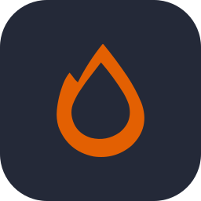
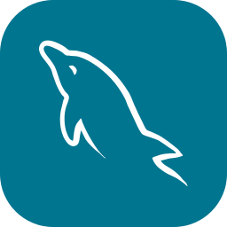
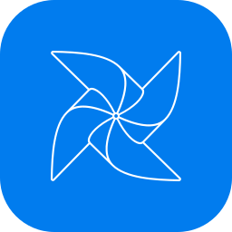
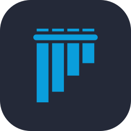
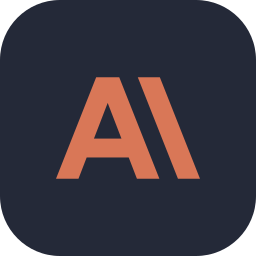
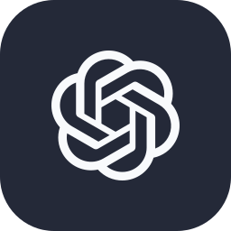
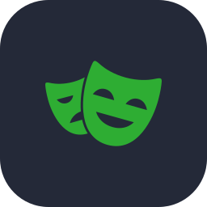

## 🎮 Player profile

| | |
|---|---|
| **Class** | Senior Full Stack Engineer |
| **Subclass** | AI agents and automation |
| **XP** | 4+ years shipping web products end to end |
| **Base** | Bogotá, Colombia · remote |
| **Languages** | Spanish (native) · English (professional) |

I build web products from the database to the UI, and bring in automation and AI agents when the problem
calls for them. My most recent work was on a US automotive startup's platform, in English, on a remote team.
Along the way I have mentored newer developers, done code reviews and handled production incidents.

## 🏆 Achievements unlocked

| | Achievement | How it was earned |
|:---:|---|---|
| 📈 | **High score**: about 500 candidates registered in two months | AI sourcing tooling adopted by at least 5 people across Talent Engineering and HR, who get a scored shortlist with the reasoning behind each contact |
| ⚡ | **Speedrun**: heavy queries from about 10 minutes to 2–3 seconds | Nightly AWS Lambda jobs that precompute and cache results over millions of vehicle listings |
| 🤖 | **Party of seven**: 7 sourcing pipelines running in parallel | Multi-agent orchestration with Claude Code, MCP servers and browser automation, with human approval before any message goes out |
| 🛡️ | **Damage reduction**: about 80% fewer agent errors, measured by the client | A web app with automation over a telecom's legacy system, used by about 200 call-center agents |
| ⭐ | **Level up ×3**: three promotions in under two years | RPA Analyst I to IV, owning projects from client requirements to production |
| 🧱 | **World builder**: three production web apps on one platform | Node.js, Hono and React plus Python and FastAPI, on PostgreSQL/PostGIS and AWS |

## 🧰 Loadout

<table>
  <tr>
    <td colspan="2" align="center"><b>⌨️ Languages</b>  
       
      TypeScript · Python · JavaScript · SQL · Java
    </td>
  </tr>
  <tr>
    <td width="50%" valign="top"><b>⚙️ Backend</b>  
      
      
       
      Node.js · Hono · Express · NestJS · FastAPI · REST APIs
    </td>
    <td width="50%" valign="top"><b>🎨 Frontend</b>  
       
      React · Angular · HTML · CSS
    </td>
  </tr>
  <tr>
    <td valign="top"><b>🗄️ Data</b>  
      
      
       
      PostgreSQL · PostGIS · MySQL · Redshift · Apache Airflow
    </td>
    <td valign="top"><b>☁️ Cloud and delivery</b>  
      
       
      AWS (Lambda, Step Functions, S3, EC2) · Docker · GitHub Actions · CI/CD · Git · pytest
    </td>
  </tr>
  <tr>
    <td valign="top"><b>🧠 AI / LLM</b>  
      
      
       
      Anthropic API · OpenAI API · MCP · AI agents · tool calling · prompt caching · LLM evals · RAG
    </td>
    <td valign="top"><b>🔁 Automation</b>  
      
       
      Playwright · Selenium · Pywinauto · web scraping · RPA
    </td>
  </tr>
</table>

## 🗺️ Quest log

| Stage | Role | Mission |
|---|---|---|
| 2026 | **Talent Engineer** · Niuro | Multi-agent AI pipelines that automate candidate sourcing |
| 2025 – 2026 | **Full Stack Engineer** · Niuro | Vehicle market platform for a US automotive startup: three web apps, serverless data workflows and Airflow pipelines |
| 2024 – 2025 | **Automation Developer** · Montechelo Technology | OCR pipeline, full stack apps and browser automation for insurance and telecom clients |
| 2022 – 2024 | **RPA Analyst I → IV** · GroupCOS | Full stack development and automation for call-center campaigns, owned end to end |
| 2020 – 2022 | **IT support, then security operations** | On-site network support, then monitoring about 300 firewalls (Fortinet, Palo Alto) on 24/7 shifts, which is where my reliability habits come from |

## 🎓 Academy

| Stage | Program | School |
|---|---|---|
| 2023 – 2027 | **B.Eng. in Systems Engineering** · in progress, expected March 2027 | UNIMINUTO, Bogotá |
| 2019 – 2022 | **Technologist in Information Technology** | UNIMINUTO, Bogotá |
| 2017 – 2018 | **Computer Systems Technician** | SENA, Bogotá |

Certifications: Full Stack Developer Certified Specialist (ITCertificate, 2026) ·
Front End Developer Certified Associate (ITCertificate, 2026) ·
Back End Developer Certified Professional (ITCertificate, 2021) ·
Frontend Developer (Platzi, 2025) · Docker (Udemy, 2024) · JavaScript and Python (Platzi, 2021)

## 🕹️ Featured builds

| Project | What it is | Stack |
|---|---|---|
| **[janus](https://github.com/JuanCamiloMendoza99/janus)** | A provider-agnostic LLM gateway: Claude and GPT behind a single API, with SSE streaming, tool calling, prompt caching and a cost figure attached to every request. Includes an evaluation suite and CI. | Python · FastAPI · Anthropic · OpenAI |
| **[mcp-document-chat](https://github.com/JuanCamiloMendoza99/mcp-document-chat)** | A Claude CLI chat client backed by a Model Context Protocol server, with FastMCP tools, resources and prompts, covered by a 27-test suite. | Python · MCP · FastMCP |
| **[geocast-mcs](https://github.com/JuanCamiloMendoza99/geocast-mcs)** | Geolocated alert system built on a client–server model, with zone detection, routing and its own web frontend. | Python · FastAPI · JavaScript |
| **[openai-api-playground](https://github.com/JuanCamiloMendoza99/openai-api-playground)** | Runnable OpenAI API examples: chat, vision, image generation, text-to-speech, speech-to-text, function calling and fine-tuning. | Python · OpenAI |
| **[claude-anthropic-api](https://github.com/JuanCamiloMendoza99/claude-anthropic-api)** | 23 hands-on notebooks on the Claude API: prompting, evals, tools, RAG (chunking, embeddings, BM25, hybrid), extended thinking and caching. | Jupyter · Anthropic |

## 🏋️ Training grounds

Repos I use to study and keep sharp, tagged with the `learning` topic:
[fastapi-studies](https://github.com/JuanCamiloMendoza99/fastapi-studies) ·
[java-studies](https://github.com/JuanCamiloMendoza99/java-studies) ·
[express-api-typescript](https://github.com/JuanCamiloMendoza99/express-api-typescript) ·
[NodeSocketChat-](https://github.com/JuanCamiloMendoza99/NodeSocketChat-)

## 🤝 Co-op mode

Happy to talk about full stack engineering, automation and AI agents.

- **LinkedIn**: [juan-camilo-mendoza99](https://www.linkedin.com/in/juan-camilo-mendoza99)
- **Email**: [juan.camilo.mendoza99@gmail.com](mailto:juan.camilo.mendoza99@gmail.com)

